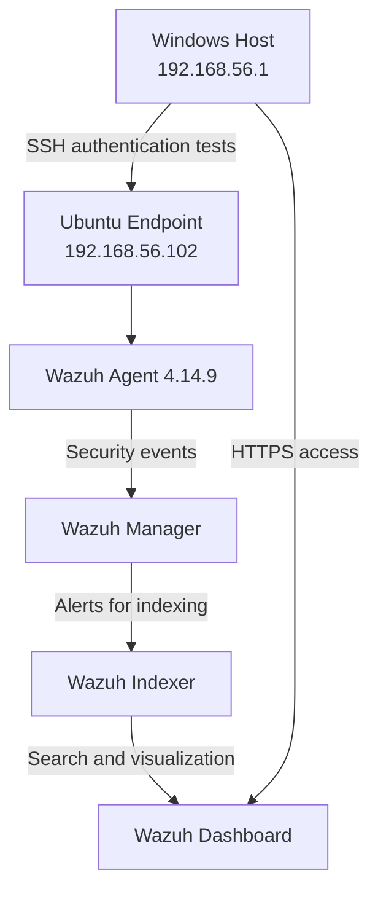

# Wazuh SIEM Fundamentals: Linux Log Collection and SSH Brute-Force Detection

## 1. Project Overview

This project introduces the fundamentals of Security Information and Event Management (SIEM) using Wazuh. It demonstrates how to collect security events from a Linux endpoint, forward them to a central Wazuh server, and investigate authentication-related alerts through the Wazuh Dashboard.

The lab focuses on Linux authentication monitoring and SSH brute-force detection in a controlled virtual environment. It provides hands-on experience with endpoint monitoring, centralized security event collection, detection rules, alert severity, and basic security investigation.

**Key highlights:**
- Deployed a Wazuh SIEM environment using the official Wazuh OVA.
- Integrated an Ubuntu 24.04.4 LTS endpoint using Wazuh Agent 4.14.9.
- Validated security event collection from the Linux endpoint.
- Simulated repeated SSH authentication failures using a non-existent username.
- Verified a brute-force detection alert using Wazuh Rule ID `5712`, Level `10`.

## 2. Real-World Scenario

A small company operates a Linux server that administrators access through SSH. The security team needs visibility into authentication activity to identify repeated login failures and potential unauthorized access attempts.

In this scenario, a user repeatedly attempts to authenticate using a non-existent username. The Linux server records the authentication events, and the Wazuh Agent forwards relevant logs to the Wazuh Manager for analysis.

Wazuh evaluates the events against its detection rules and generates an alert when the observed activity meets the configured detection conditions. The security analyst then reviews the alert and its supporting log evidence in the Wazuh Dashboard.

This project recreates that workflow in a controlled lab to demonstrate the fundamentals of security event monitoring and detection.

## 3. Project Objectives

The objectives of this project are to:

- Understand the basic architecture and workflow of a SIEM.
- Deploy Wazuh and connect a Linux endpoint using Wazuh Agent.
- Validate the collection and transmission of Linux security events.
- Understand the difference between raw log events and detection alerts.
- Simulate SSH authentication failures safely within a controlled environment.
- Examine Wazuh detection rules, alert severity, source IP addresses, and event details.
- Document the results using evidence from the Wazuh Dashboard.

## 4. Lab Architecture

The lab consists of a Windows host, an Ubuntu endpoint, and a Wazuh SIEM server running in VirtualBox.

### Component Roles

| Component | Purpose |
|---|---|
| Windows Host | Initiates controlled SSH authentication tests and accesses the dashboard. |
| Ubuntu Endpoint | Generates Linux authentication events and runs the Wazuh Agent. |
| Wazuh Agent | Collects relevant endpoint events and forwards them to the Wazuh Manager. |
| Wazuh Manager | Processes incoming events and evaluates them using decoders and detection rules. |
| Wazuh Indexer | Stores and indexes data for searching and analysis. |
| Wazuh Dashboard | Provides visualizations and access to events, alerts, and investigation details. |

## 5. Tools and Technologies

- **Wazuh SIEM 4.14.9** — Centralized security monitoring and detection.
- **Ubuntu Desktop 24.04.4 LTS** — Linux monitoring endpoint.
- **Wazuh Agent 4.14.9** — Endpoint event collection and forwarding.
- **Oracle VirtualBox 7.2.20** — Virtualization platform.
- **Windows PowerShell** — SSH test execution.
- **OpenSSH Server** — Remote authentication service on Ubuntu.
- **Wazuh Dashboard** — Event monitoring and alert investigation.

## 6. Key Detection Result

The SSH authentication test generated a Wazuh brute-force detection alert.

| Field | Observed Value |
|---|---|
| Detection Rule ID | `5712` |
| Alert Level | `10` |
| Detection Description | `sshd: brute force trying to get access to the system. Non existent user.` |
| Source IP | `192.168.56.1` |
| Target Endpoint | `daniel-rr-VM` |
| Target IP | `192.168.56.102` |
| Attempted Username | `siem-lab-unknown` |

The result demonstrates that Wazuh correlated repeated SSH authentication activity and generated a brute-force detection alert under the active rule configuration.

The test was performed entirely within a controlled local lab. It demonstrates the observed detection behavior and does not establish that every brute-force pattern will be detected or that an unauthorized login was successful.

## 7. Evidence

Screenshots from the lab are included to document the implementation and results.

- **Agent Connectivity** — Wazuh Dashboard showing the Ubuntu endpoint registered with an `Active` status.
- **SSH Brute-Force Detection** — Alert details showing Rule ID `5712`, Level `10`, the source IP, and the attempted username.

Additional screenshots and investigation notes can be added to the `evidence/` directory as the documentation is finalized.

> ## Phase 1 — SIEM Environment Setup

### Objective

The objective of this phase was to deploy the Wazuh SIEM environment in VirtualBox and verify that the Wazuh Dashboard was accessible from the Windows host.

### Implementation

The official Wazuh 4.14.9 OVA was imported into Oracle VirtualBox. The appliance includes the Amazon Linux 2023 operating system and the core Wazuh components required for centralized security monitoring.

The virtual machine was configured with the following resources:

| Configuration | Value |
|---|---|
| Virtualization Platform | Oracle VirtualBox 7.2.20 |
| Wazuh Version | 4.14.9 |
| Operating System | Amazon Linux 2023 |
| CPU | 4 virtual CPUs |
| Memory | 8 GB RAM |
| Graphics Controller | VMSVGA |
| Network Mode | Host-only Adapter |
| Wazuh Server IP | 192.168.56.101 |

A Host-only network was configured to allow the Windows host to access the Wazuh Dashboard without exposing the lab server directly to the physical network.

### Validation

The following checks were completed:

- Successfully imported and booted the Wazuh OVA.
- Verified the Wazuh server's host-only IP address.
- Accessed the Wazuh Dashboard through HTTPS from the Windows host.
- Confirmed that the dashboard displayed security monitoring information.

At this stage, no separate Ubuntu monitoring endpoint had been registered yet. Endpoint integration was performed in Phase 2.

### Outcome

The Wazuh SIEM environment was successfully deployed and made accessible through the local lab network. The environment was ready for Linux endpoint integration and subsequent security event collection.

### Evidence

The following screenshots document the Phase 1 implementation:

### 1. Wazuh virtual machine configuration.

### 2. Host-only network configuration.

### 3. Wazuh server IP address.

### 4. Successful access to the Wazuh Dashboard.

> ## Phase 2 — Linux Endpoint Integration

### Objective

The objective of this phase was to integrate an Ubuntu Linux endpoint with the Wazuh SIEM server and establish centralized security event monitoring.

### Implementation

An Ubuntu 24.04.4 LTS virtual machine was deployed in Oracle VirtualBox as the monitored endpoint. The system was configured with two virtual network adapters to support internet connectivity and private communication with the Wazuh server.

The Wazuh Agent was installed and configured to communicate with the Wazuh Manager at `192.168.56.101`.

OpenSSH Server was also installed and enabled to provide a controlled SSH authentication test scenario for subsequent detection testing.

### Endpoint Configuration

| Configuration | Value |
|---|---|
| Virtual Machine Name | `Ubuntu-SIEM-Target` |
| Operating System | Ubuntu Desktop 24.04.4 LTS |
| CPU | 2 virtual CPUs |
| Memory | 4 GB RAM |
| Virtual Disk | 35 GB |
| NAT Interface IP | `10.0.2.15` |
| Host-only Interface IP | `192.168.56.102` |
| Wazuh Agent Version | 4.14.9 |
| Wazuh Manager IP | `192.168.56.101` |
| Wazuh Agent ID | `001` |
| Agent Status | Active |

### Network Configuration

Two network adapters were configured for the Ubuntu endpoint:

- **NAT:** Provided internet access for downloading packages and installing software.
- **Host-only Adapter:** Enabled private communication between the Ubuntu endpoint and the Wazuh server.

The Ubuntu endpoint and Wazuh server were connected to the same Host-only subnet, `192.168.56.0/24`.

Connectivity was validated by successfully pinging the Wazuh server from Ubuntu, with four packets sent and received and no packet loss.

### Wazuh Agent Installation and Validation

The official Wazuh APT repository was configured, and Wazuh Agent version `4.14.9-1` was installed on Ubuntu.

The agent was configured to use the Wazuh Manager at `192.168.56.101`. The service was enabled to start automatically and started successfully.

Validation confirmed that:

- The Wazuh Agent service was running.
- The Ubuntu endpoint appeared in Wazuh Dashboard with an `Active` status.
- The endpoint was registered with Agent ID `001`.
- Ubuntu security events were visible in Wazuh Threat Hunting.

### SSH Service Preparation

OpenSSH Server was installed and verified as active and enabled. It was prepared as the authentication service for controlled SSH failure simulations in subsequent phases.

SSH was used as the test service; it is separate from the communication channel used by the Wazuh Agent.

### Outcome

The Ubuntu endpoint was successfully integrated with the Wazuh SIEM environment. The active agent status and visible endpoint events confirmed that the endpoint could communicate with the Wazuh Manager and participate in centralized security monitoring.

This established the foundation for the subsequent phases covering log validation, SSH authentication failure simulation, and brute-force alert investigation.

### Evidence

The following screenshots document the endpoint integration:

### 1. Ubuntu virtual machine network configuration.

### 2. Ubuntu network interfaces and assigned IP addresses.

### 3. OpenSSH Server service status.

### 4. Wazuh Dashboard showing the registered Ubuntu endpoint as Active.

> ## Phase 3 — Log Collection and Validation

### Objective

The objective of this phase was to validate that security events from the Ubuntu endpoint were available in the Wazuh Dashboard and could be investigated using the Threat Hunting interface.

### Event Collection Validation

After the Ubuntu endpoint was registered and marked as Active, Threat Hunting was used to search for events associated with the agent `daniel-rr-VM`.

The search returned endpoint-related events, including:

- AppArmor access-denied events.
- PAM authentication and session events.
- Security Configuration Assessment (SCA) summary events.
- SSH authentication failure events.

These results demonstrated that the Wazuh environment was receiving and presenting security-related event data associated with the Ubuntu endpoint.

### SSH Authentication Failure Test

A controlled SSH authentication test was performed from the Windows host against the Ubuntu endpoint. An incorrect password was entered to generate an authentication failure.

The event was subsequently located in the Wazuh Dashboard.

| Field | Observed Value |
|---|---|
| Endpoint | `daniel-rr-VM` |
| Endpoint IP | `192.168.56.102` |
| SSH Source IP | `192.168.56.1` |
| Event Description | `sshd: authentication failed.` |
| Rule ID | `5760` |
| Rule Level | `5` |

The authentication failure was recorded as an individual event. This validated the event collection and investigation workflow before performing repeated authentication attempts in the next phase.

### Event Investigation

The event details were reviewed to identify relevant information, including the timestamp, agent identity, rule metadata, and available log evidence.

This exercise also established an important distinction:

- **Events and logs** provide evidence of system activity.
- **Detection alerts** are generated when events match the conditions defined by active detection rules.
- **Rule level** indicates the severity assigned by Wazuh; it does not independently prove that an attack succeeded.

The Threat Hunting results represent the event data available through the configured Wazuh indexing and detection pipeline. This test does not establish that every raw system log is collected or indexed.

### Outcome

The Ubuntu endpoint's security-related events were visible in Wazuh Threat Hunting, and a controlled SSH authentication failure was successfully recorded and investigated.

This established the foundation for Phase 4, where repeated SSH authentication attempts were used to test Wazuh's brute-force detection rules.

### Evidence

- **Endpoint Event Search:** Threat Hunting results filtered by `agent.name: "daniel-rr-VM"`.

- **SSH Authentication Failure:** Detailed event view showing Rule ID `5760` and Level `5`.

> ## Phase 4 — SSH Simulation and Brute-Force Detection

### Objective

The objective of this phase was to simulate repeated SSH authentication failures and validate whether Wazuh could identify the activity as a potential brute-force attempt.

### Test Scenario

A controlled authentication test was performed from the Windows host against the Ubuntu endpoint using SSH. The test repeatedly attempted authentication with a non-existent username, `siem-lab-unknown`.

The test was conducted entirely within the local VirtualBox lab environment. No external systems were targeted.

### Test Environment

| Component | Value |
|---|---|
| Test Source | Windows Host |
| Source IP | `192.168.56.1` |
| Target Endpoint | `daniel-rr-VM` |
| Target IP | `192.168.56.102` |
| Protocol | SSH |
| Target Username | `siem-lab-unknown` |
| Wazuh Agent Version | 4.14.9 |

### Test Procedure

1. Initiated SSH connections from Windows PowerShell to the Ubuntu endpoint.
2. Used a non-existent username and intentionally incorrect authentication credentials.
3. Repeated the attempts in a controlled sequence of eight SSH connection attempts.
4. Inspected the resulting authentication events in Wazuh Threat Hunting.
5. Examined the correlated brute-force alert and its detection metadata.

### Detection Result

Wazuh generated a brute-force detection alert after the repeated authentication activity.

| Field | Observed Value |
|---|---|
| Rule ID | `5712` |
| Rule Level | `10` |
| Rule Description | `sshd: brute force trying to get access to the system. Non existent user.` |
| Source IP | `192.168.56.1` |
| Target Endpoint | `daniel-rr-VM` |
| Attempted Username | `siem-lab-unknown` |
| Rule Frequency | `8` |

The alert details also included related SSH event information, providing supporting evidence for the detection.

### Analysis

The test demonstrated two distinct detection behaviors:

- **Individual authentication failures:** Wazuh recorded individual SSH and PAM authentication events, including events associated with Rule ID `5760`, Level `5`.
- **Repeated authentication activity:** Wazuh generated a separate brute-force detection alert under Rule ID `5712`, Level `10`.

The Level 10 alert did not replace or change the severity of the individual Level 5 events. It represented a separate detection generated through correlation of repeated activity.

### Outcome

The controlled test successfully triggered Wazuh's brute-force detection rule for repeated SSH attempts involving a non-existent username.

This demonstrated the practical difference between collecting authentication logs and correlating repeated events into a higher-severity security alert.

The result reflects the active Wazuh rules and configuration used in this lab. It does not prove that all brute-force attempts will be detected or that an unauthorized login was successful.

### Evidence

The following evidence documents the simulation and its detection:

### 1. PowerShell output showing the controlled repeated SSH authentication attempts.

### 2. Wazuh Threat Hunting showing the brute-force detection alert.

### 3. Detailed alert information showing Rule ID `5712`, Level `10`, source IP, attempted username, and available correlation metadata.

> ## Conclusion

This project provided hands-on experience with the fundamentals of Security Information and Event Management (SIEM) using Wazuh. It demonstrated how to integrate a Linux endpoint with a centralized security monitoring platform, collect authentication events, and investigate alerts generated by detection rules.

The lab successfully established communication between an Ubuntu 24.04.4 LTS endpoint and the Wazuh SIEM environment. Security events from the endpoint were visible in Wazuh Threat Hunting, and a controlled SSH authentication test generated a brute-force detection alert.

The key result was the detection of repeated SSH authentication attempts involving a non-existent username. Wazuh generated **Rule ID 5712, Level 10**, demonstrating how individual authentication events can be correlated to identify a potentially suspicious pattern.

### Key Takeaways

Through this project, I gained practical experience in:

- Deploying and configuring a Wazuh SIEM environment using VirtualBox.
- Integrating a Linux endpoint through the Wazuh Agent.
- Understanding the flow of security events from an endpoint to the SIEM.
- Distinguishing individual log events from correlated detection alerts.
- Investigating alert details, including rule IDs, severity levels, source IP addresses, and attempted usernames.
- Understanding how SIEM detection rules support security monitoring and investigation.

### Project Limitations

This project focused on a single Linux endpoint and a controlled SSH authentication scenario. The results demonstrate the behavior of the active Wazuh rules in this lab, not comprehensive protection against all brute-force techniques or unauthorized access attempts.

The project also did not evaluate production-scale deployments, custom detection rules, automated incident response, or long-term log retention.

### Final Reflection

This project established a foundation for further learning in SIEM operations, security event analysis, and threat detection. Understanding how logs are collected, analyzed, and correlated is an important first step toward investigating security incidents and working with broader cloud security monitoring solutions.

**Project Status:** Completed — Wazuh SIEM Fundamentals.

